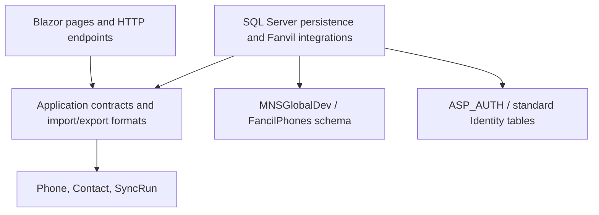

# FancilPhones

ASP.NET Core 10 / Blazor Server application for managing Fanvil handsets, a shared phonebook, and synchronization history.

## Architecture

The solution follows BIDevHub's layered approach, with dependencies directed toward application contracts and domain models:



- `src/FancilPhones.Domain`: phone, contact, and activity models.
- `src/FancilPhones.Application`: use-case contracts, authorization boundary, network range parsing, and CSV/XLSX formats.
- `src/FancilPhones.Infrastructure`: separate EF contexts, SQL migrations, transactional data operations, legacy import, network discovery, and handset communication.
- `FancilPhones`: Blazor UI, authentication endpoints, request/circuit user access, and dependency injection composition.
- `tests/FancilPhones.Tests`: isolated persistence and HTTP authentication tests, plus explicit read-only live checks.

Blazor components use application interfaces, not EF contexts. Services enforce authorization before database mutations or handset configuration changes. Each database operation uses its own context, avoiding circuit-long EF tracking and concurrent context use during fleet syncs.

## Database configuration

The two required connection names are `ASP_Auth` and `MNSGlobalDev`. Configure their values outside source control. Development uses .NET user secrets:

```powershell
dotnet user-secrets set "ConnectionStrings:ASP_Auth" "<ASP_AUTH SQL Server connection string>" --project FancilPhones
dotnet user-secrets set "ConnectionStrings:MNSGlobalDev" "<MNSGlobalDev SQL Server connection string>" --project FancilPhones
dotnet run --project FancilPhones --launch-profile https
```

For deployment, use the host's secret configuration or environment variables `ConnectionStrings__ASP_Auth` and `ConnectionStrings__MNSGlobalDev`. User secrets are loaded automatically only in Development. There is no SQLite fallback.

`AppDbContext` owns only `[FancilPhones].[Phones]`, `[FancilPhones].[Contacts]`, and `[FancilPhones].[SyncRuns]` in MNSGlobalDev. Its migration history is `[FancilPhones].[__EFMigrationsHistory]`, separate from other applications in that database. UTC timestamps retain their UTC kind when read from SQL Server.

`AuthDbContext` uses the same standard `IdentityUser`, roles, and Identity schema version 3 as BIDevHub. This application never creates or migrates authentication tables, seeds users or roles, or changes the shared account schema. Normal Identity sign-in can update lockout counters, authenticator tokens, and security metadata in ASP_AUTH.

By default the app applies only its phone migrations at startup, matching BIDevHub's migration lifecycle. Deployment environments can set `Database__ApplyMigrationsOnStartup=false` and apply them separately with an account that has schema permissions:

```powershell
dotnet tool restore
dotnet run --project FancilPhones --launch-profile https -- --migrate-database
```

## Authentication and access

Sign in with the same employee ID and password used for BIDevHub. The app uses Identity password verification, shared lockout settings, authenticator/recovery-code verification, antiforgery-protected form posts, authentication rate limiting, local return URLs, and security-stamp revalidation for cookies and connected Blazor circuits.

Sessions use FancilPhones-specific cookies. Sharing the identity database does not enable automatic single sign-on across applications.

| ASP_AUTH role | Access |
| --- | --- |
| `BI-ADMIN` or `IT_ADMIN` | Manage phones and contacts; import, export fleet credentials, discover handsets, push SIP settings, and run syncs |
| Other authenticated accounts | View dashboard, phones, contacts, logs; export the phonebook; probe an existing handset |
| Anonymous | Sign-in and verification pages only; phone data and exports require authentication |

Accounts, password changes/resets, authenticator setup, and role assignments are managed centrally. The old local `admin/admin` account is not provisioned or imported. `/users` and `/account/change-password` explain central account management.

## Import an existing SQLite database

The initial migration for this workspace imported **51 phones, 61 contacts, and 409 activity records** into MNSGlobalDev. Do not rerun the import against that populated store.

For a fresh environment, stop writers to the legacy store and retain a SQLite backup. Run:

```powershell
dotnet run --project FancilPhones --launch-profile https -- --import-sqlite "C:\path\to\fancilphones.db"
```

This explicit operation applies phone migrations, reads the legacy database in read-only mode, and imports only the three phone tables. It preserves IDs, relationships, SIP configuration, handset credentials, and timestamps. The destination must be empty; the import refuses populated tables and uses a transaction so a failed import rolls back all imported rows. It never imports SQLite users, passwords, or roles into ASP_AUTH. Retain the legacy snapshot until verification is complete.

## Verification

```powershell
dotnet build FancilPhones.sln --configuration Release
dotnet test FancilPhones.sln
```

Normal tests use isolated SQLite databases and synthetic employee accounts, so they do not contact shared SQL Server databases or real handsets. They cover role enforcement, transaction rollback, UTC handling, authentication/lockout, two-factor recovery, safe redirects, antiforgery protection, and export access.

To opt into read-only verification of the configured live databases and compare all imported fields with the original snapshot:

```powershell
$env:FANCILPHONES_TEST_LIVE_DATABASES = "1"
$env:FANCILPHONES_LEGACY_DATABASE = "C:\path\to\fancilphones.db"
dotnet test tests/FancilPhones.Tests --filter FullyQualifiedName~LiveDatabaseTests
Remove-Item Env:FANCILPHONES_TEST_LIVE_DATABASES
Remove-Item Env:FANCILPHONES_LEGACY_DATABASE
```

The comparison reports digests rather than record contents so handset credentials do not appear in test diagnostics.

## Git

Build output, IDE state, user settings, local database files, and local secret configuration are ignored. Previously tracked copies of those files have been removed from the index; their working copies are preserved. Source, migrations, tests, documentation, and the local EF tool manifest belong in Git. Ignore rules do not remove files from earlier commits.
