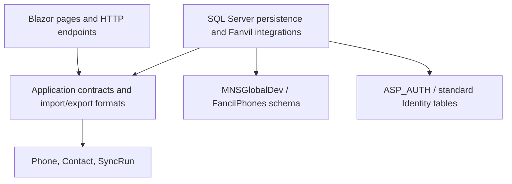

# FancilPhones

ASP.NET Core 10 / Blazor Server application for managing Fanvil handsets, a shared phonebook, and synchronization history.

## Interface

The voice workspace uses Radzen icons and Radzen dialogs with a custom warm graphite and amber theme. Every container, control, status badge, and modal has square corners. Typography and icon fonts are served locally through the Radzen package. MudBlazor is not a dependency.

The responsive shell includes a collapsible desktop sidebar and mobile navigation. Fleet, phonebook, and activity tables include search, filters, pagination, and contained horizontal scrolling on smaller screens. Editors use validated Blazor forms; text fields update validation while typing. Imports, deletions, SIP pushes, and fleet synchronization show explicit confirmation dialogs. Informational notifications dismiss after seven seconds; warnings and errors remain until dismissed.

Shared UI components live in `FancilPhones/Components/Shared`, circuit-scoped feedback lives in `FancilPhones/UI`, and visual tokens and layout rules live in `FancilPhones/wwwroot/app.css`. `AppDialog` adapts controlled component state to Radzen's dialog lifecycle; it does not implement a separate modal system.

## Architecture

The solution follows BIDevHub's layered approach, with dependencies directed toward application contracts and domain models:



- `src/FancilPhones.Domain`: phone, contact, and activity models.
- `src/FancilPhones.Application`: use-case contracts, authorization boundary, network range parsing, and CSV/XLSX formats.
- `src/FancilPhones.Infrastructure`: separate EF contexts, SQL migrations, transactional data operations, legacy import, network discovery, and handset communication.
- `FancilPhones`: Blazor UI, authentication endpoints, request/circuit user access, and dependency injection composition.
- `tests/FancilPhones.Tests`: isolated persistence and HTTP authentication tests, plus explicit read-only live checks.

Blazor components use application interfaces, not EF contexts. Services enforce authorization before database mutations or handset configuration changes. Each database operation uses its own context, avoiding circuit-long EF tracking and concurrent context use during fleet syncs.

## Database configuration

The two required connection names are `ASP_Auth` and `MNSGlobalDev`. The supplied MNS-SQL connections are configured in `FancilPhones/appsettings.json` and are included in the publish output. Both local runs and IIS use these settings. Optional development overrides use .NET user secrets:

```powershell
dotnet user-secrets set "ConnectionStrings:ASP_Auth" "<ASP_AUTH SQL Server connection string>" --project FancilPhones
dotnet user-secrets set "ConnectionStrings:MNSGlobalDev" "<MNSGlobalDev SQL Server connection string>" --project FancilPhones
dotnet run --project FancilPhones --launch-profile https
```

For IIS, deploy the complete publish folder, including `appsettings.json` and the generated `web.config`. The app pool reads both configured connections from `appsettings.json`; development user secrets are not required on the server. Restart the app pool after replacing the published files. `appsettings.Production.json` and environment variables `ConnectionStrings__ASP_Auth` / `ConnectionStrings__MNSGlobalDev` take precedence if present, so remove stale empty overrides. The IIS server must be able to reach MNS-SQL. There is no SQLite fallback.

`AppDbContext` owns the phone, contact, activity, and switchboard tables in the `FancilPhones` schema in MNSGlobalDev. Its migration history is `[FancilPhones].[__EFMigrationsHistory]`, separate from other applications in that database. UTC timestamps retain their UTC kind when read from SQL Server.

`AuthDbContext` uses the same standard `IdentityUser`, roles, and Identity schema version 3 as BIDevHub. This application never creates or migrates authentication tables, seeds users or roles, or changes the shared account schema. Normal Identity sign-in can update lockout counters, authenticator tokens, and security metadata in ASP_AUTH.

By default the app applies only its phone migrations at startup, matching BIDevHub's migration lifecycle. Deployment environments can set `Database__ApplyMigrationsOnStartup=false` and apply them separately with an account that has schema permissions:

```powershell
dotnet tool restore
dotnet run --project FancilPhones --launch-profile https -- --migrate-database
```

## Authentication and access

Sign in with the same employee ID and password used for BIDevHub. The app uses Identity password verification, shared lockout settings, authenticator/recovery-code verification, antiforgery-protected form posts, authentication rate limiting, local return URLs, and security-stamp revalidation for cookies and connected Blazor circuits.

Sessions use FancilPhones-specific cookies. Sharing the identity database does not enable automatic single sign-on across applications.

| ASP_AUTH role | Access |
| --- | --- |
| `BI-ADMIN` or `IT_ADMIN` | Manage phones and contacts; import, export fleet credentials, discover handsets, push SIP settings, and run syncs |
| Other authenticated accounts | View dashboard, phones, contacts, logs; export the phonebook; probe an existing handset |
| Anonymous | Sign-in and verification pages only; phone data and exports require authentication |

Accounts, password changes/resets, authenticator setup, and role assignments are managed centrally. The old local `admin/admin` account is not provisioned or imported. `/users` and `/account/change-password` explain central account management.

## Import an existing SQLite database

The initial migration for this workspace imported **51 phones, 61 contacts, and 409 activity records** into MNSGlobalDev. Do not rerun the import against that populated store.

For a fresh environment, stop writers to the legacy store and retain a SQLite backup. Run:

```powershell
dotnet run --project FancilPhones --launch-profile https -- --import-sqlite "C:\path\to\fancilphones.db"
```

This explicit operation applies phone migrations, reads the legacy database in read-only mode, and imports only the three phone tables. It preserves IDs, relationships, SIP configuration, handset credentials, and timestamps. The destination must be empty; the import refuses populated tables and uses a transaction so a failed import rolls back all imported rows. It never imports SQLite users, passwords, or roles into ASP_AUTH. Retain the legacy snapshot until verification is complete.

## Async work and cancellation

Data pages and editors inherit `AsyncComponentBase`, which cancels owned work on navigation, disposal, request abort, and application shutdown. Tokens flow through authorization, EF queries and transactions, file reads, CSV/XLSX parsing checkpoints, and handset socket/TLS operations. Expected cancellation does not show an error notification. Dialog confirmations release their pending state when cancelled. Refreshes and mutations cannot overlap, and independent dashboard reads use separate DbContexts concurrently.

Synchronization has a **Stop sync** action. Cancelling stops queued work and interrupts active calls, waits for workers to settle, and records started handsets as `Cancelled` with a finish time. Timeouts are recorded as `TimedOut`. Handset changes already applied cannot be rolled back; review history and verify affected phones before retrying. Logout and final history persistence each receive a separate, bounded cleanup token. Shutdown cancels active sync and discovery operations too.

`PhoneOperations` in `appsettings.json` controls `MaxConcurrentSyncs` (8), `TimeoutSeconds` (60 per handset operation), and `CleanupTimeoutSeconds` (3 per cleanup phase). These settings are validated at startup. A fleet run has at most the configured number of active workers. Discovery limits ranges to 4,096 addresses, bounds both workers and buffered results, cancels producers when enumeration ends early, and throttles UI progress renders to roughly ten per second. Socket responses are bounded to 4 MB; incomplete replies fail, and mutating POSTs are never automatically replayed.

Read-only queries avoid EF tracking. Delivery history filters in SQL before limiting results and projects only handset identity fields, excluding credentials. Bulk replacements use set-based deletes within transactions, so failure or cancellation rolls back deletions and cascaded history. Sync completion updates only delivery metadata, preserving concurrent edits to handset configuration.

CSV parsing and row processing check cancellation cooperatively. ClosedXML workbook loading/saving has synchronous APIs; cancellation is checked before and after those calls and between rows, rather than presenting those calls as cancellable asynchronous I/O.

## Loading and interaction feedback

`AsyncButton`, `LoadingState`, and the circuit-scoped `UiActivity` service provide shared pending states. Page loads stream a status panel and show a thin workspace progress indicator. Refreshes, saves, handset commands, imports, and exports show progress text or a spinner; controls reject duplicate actions while work is pending. Activity leases clear independently on completion, failure, cancellation, or navigation, so overlapping work cannot hide another operation's indicator. Motion follows the operating system's reduced-motion preference.

Fleet synchronization displays actual completed/total and success/failure counts as handset operations finish. The confirmation stage, active delivery, stopping, and completion have separate text. Stop sync remains available during delivery. Cancellation keeps completed results visible and retains handset activity history.

Exports use a same-origin cancellable request, keep their button pending until the file is ready, and report failures without pretending the download succeeded. Conventional sign-in, verification, and sign-out form submissions show pending text and prevent duplicate submissions; returning through browser history restores the original controls. Immediate local filters and dialog-opening actions do not introduce artificial delays.

## Operational logging

Application components and infrastructure services use the built-in `ILogger<T>` pipeline. Authentication outcomes, authorization denials, completed data changes, imports, exports, migrations, discovery, probes, SIP pushes, and phonebook deliveries emit structured events. UI handlers log caught exceptions before showing a friendly error; unhandled request and circuit exceptions retain the ASP.NET Core diagnostics.

Console output uses UTC timestamps and scopes. Each handset operation includes `PhoneId`, `SyncRunId`, and `Operation`; fleet deliveries and discovery runs include a shared correlation ID. Information records operation outcomes, Warning records expected rejection/device failures, Error records unexpected handled failures, and Critical records startup database initialization failure. Detailed per-probe/protocol metadata is Debug. Ordinary EF SQL command output is filtered to Warning.

Logs include IDs, counts, statuses, and diagnostic exceptions. They do not intentionally include passwords, connection strings, authentication codes, cookie values, contact details, or raw handset request/response bodies. Device nonce failures also omit raw response headers. Change category levels through `Logging:LogLevel` in appsettings or host configuration; application categories start with `FancilPhones`.

IIS receives the built-in Windows Event Log provider for Warning and higher by default (Application log). Console output is visible when running the executable directly or under a host that collects stdout. For temporary IIS startup diagnostics, enable `stdoutLogEnabled` on the generated `aspNetCore` element in the deployed `web.config`, create its log directory, and grant the app pool write permission there. Disable stdout capture after troubleshooting; IIS stdout files do not rotate automatically. No separate file logging provider is installed.

## Switchboard function keys

Administrators can open **Switchboard keys** (`/switchboards`) to manage only `192.168.55.101`, `.113`, `.133`, `.147`, and `.150`. Standard phones, including `.136`, are rejected by the service before any handset connection. This workflow is independent of phonebook and SIP synchronization.

1. Capture each handset's current keys. The observed `sideKey.htm` protocol must return exactly five pages of twelve keys. Capturing uses the handset's page-selection form (`DefaultLoad`), without applying configuration changes.
2. Review any preflight warning. Page 1 F1 must be a configured Line key. Reception F2 is Memory Key / Overide Day/Night / `*271` / None; other switchboards use Memory Key / Reception / `201` / BLF/BXFER. If F2 differs, **Preview F2 setup** prepares a separate, explicit correction of that key only. Deploying this setup preserves all other keys. An invalid F1 or other special keys require manual review. Setup backups are retained for audit; restoring an invalid protected-key configuration is blocked.
3. Import each capture. Contacts merge into the existing shared phonebook by normalized name. Existing master numbers remain unchanged; handset-specific extension differences and Value2 values become explicit overrides. Captured contact settings follow the contact ID when the master name changes. Duplicate names are rejected. Importing again deliberately re-adopts that handset's captured values.
4. Select the shared contacts to include (maximum 58) and optionally set sort names. Edit names and office numbers through the shared contact editor. Imported extension overrides remain local until cleared; a blank override means use the master office number. Saving a blank Value2 explicitly clears it. Unmapped contacts use their captured Value2 when available. Replacing the shared phonebook deletes switchboard memberships and overrides through foreign-key cascades; re-import captures and review selection afterwards.
5. Preview one phone or selected phones. Contacts are sorted with `en-ZA` collation across all editable positions, starting at Page 1 F3 and continuing at Page 2 F1. Page 1 F1/F2 and global handset settings remain unchanged. Existing subtype, pickup, media and icon settings travel with the contact. New contacts use the handset's captured BLF defaults. Overflow, duplicate names, invalid numbers and field-length violations block the preview. Removal clears trailing positions.
6. Review the before/after table and deploy. Previews are immutable server-side snapshots and expire after 30 minutes. Master/override changes, profile changes or handset drift require a new preview. A database lease prevents overlapping deployments to a handset. Pages are applied sequentially without replaying mutating requests; each changed page and the final five-page layout must read back correctly before success is recorded. A fleet delivery stops on its first failure.

Each delivery retains its complete before/after configuration in `SwitchboardDeployments`. **Preview restoration** reads the handset afresh and prepares restoration from an attempted layout delivery's original backup. Restoration is reviewed and verified like a normal delivery, and cannot change protected keys. Interrupted delivery may have applied earlier pages; cancellation is not rollback. Active handset work obeys the configured timeouts, cancellation and application shutdown. Only administrators can capture, import, edit membership/overrides, preview, deploy or restore.

Confirm the handset provider/PBX provisioning policy before the first deployment: an independent provisioning service can subsequently overwrite local key changes. No new provisioning service is installed or configured by this feature. Initial live integration checks were read-only; production key delivery requires an operator-reviewed preview and functional call/BLF/transfer checks on a pilot handset.

## Verification

```powershell
dotnet build FancilPhones.sln --configuration Release
dotnet test FancilPhones.sln
node --test tests/loading-feedback.test.mjs
```

Normal tests use isolated SQLite databases and synthetic employee accounts, so they do not contact shared SQL Server databases or real handsets. They cover role enforcement, transaction rollback, UTC handling, authentication/lockout, two-factor recovery, safe redirects, antiforgery protection, export access, cancellation/timeout history, bounded concurrency, worker disposal, socket/TLS cancellation, transaction rollback on cancellation, and preserving concurrent phone edits.

To opt into read-only verification of the configured live databases and compare all imported fields with the original snapshot:

```powershell
$env:FANCILPHONES_TEST_LIVE_DATABASES = "1"
$env:FANCILPHONES_LEGACY_DATABASE = "C:\path\to\fancilphones.db"
dotnet test tests/FancilPhones.Tests --filter FullyQualifiedName~LiveDatabaseTests
Remove-Item Env:FANCILPHONES_TEST_LIVE_DATABASES
Remove-Item Env:FANCILPHONES_LEGACY_DATABASE
```

The comparison reports digests rather than record contents so handset credentials do not appear in test diagnostics.

## Git

Build output, IDE state, user settings, local database files, and local secret configuration are ignored. Previously tracked copies of those files have been removed from the index; their working copies are preserved. Source, migrations, tests, documentation, and the local EF tool manifest belong in Git. Ignore rules do not remove files from earlier commits.
